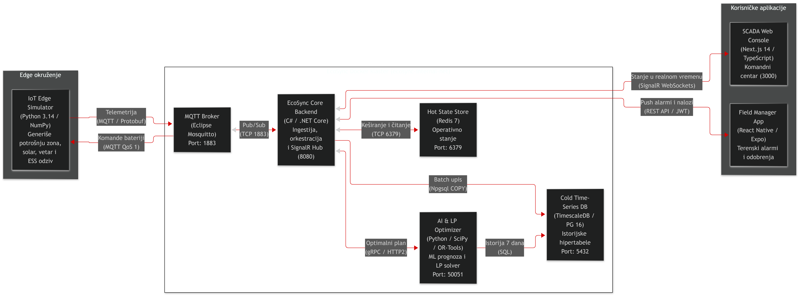

# 🌱 EcoSync: Smart City Renewable Energy Digital Twin & Optimization Engine


## 📌 Executive Summary
**EcoSync** is a distributed Digital Twin and real-time resource optimization platform designed for smart-city energy grids. Instead of focusing on low-level electrical circuit physics, EcoSync operates at the **macro-infrastructure level**—balancing city-wide energy demand, intermittent renewable generation (solar and wind), grid-scale battery storage, and carbon ($CO_2$) emission targets.

By combining high-throughput telemetry ingestion with predictive machine learning and linear programming, EcoSync minimizes reliance on fossil-fuel peaker plants and demonstrates fault-tolerant enterprise software architecture.

> 📚 **Engineering Whitepaper & ADRs:** For the full architectural specification, mathematical optimization models, chaos testing benchmarks, and Architecture Decision Records, explore the [**`/docs` directory**](./docs).

---

## 🏗️ High-Level System Topology



---

## 🚀 The 6-Phase Engineering Architecture

EcoSync is engineered as a modular, containerized distributed system divided into six distinct phases:

### Phase 1: IoT Edge Macro-Simulation (Data Generation)
- **Stack:** `Python`, `MQTT (Mosquitto)`, `JSON` $\rightarrow$ `Protocol Buffers (Protobuf)`
- **Role:** Simulates real-time city telemetry at 500ms intervals, streaming aggregate municipal load ($MW$), solar/wind generation curves, and grid-scale battery State-of-Charge ($SoC\%$).

### Phase 2: High-Load Core Backend & Dual-Path Storage (The Engine)
- **Stack:** `C# (.NET Core)`, `gRPC`, `Redis`, `PostgreSQL + TimescaleDB`, `Docker`, `GitHub Actions`
- **Role:** Ingests high-frequency telemetry streams using multithreaded C# workers. Implements a **Hot/Cold data path**: live grid state is written to **Redis** for sub-millisecond dashboard reads, while historical time-series metrics are asynchronously persisted into **TimescaleDB** hypertables.

### Phase 3: Predictive & Prescriptive AI Engine (The Brain)
- **Stack:** `Python`, `Scikit-learn`, `SciPy / Google OR-Tools`, `NumPy`
- **Role:** Communicates with the C# core via **gRPC**. Forecasts short-term consumption spikes and renewable drops using ML regression models, then applies **Linear Programming** to compute optimal battery charge/discharge schedules that minimize $CO_2$ output.

### Phase 4: SCADA Command Center Dashboard (Visualization)
- **Stack:** `Next.js 14`, `React`, `TypeScript`, `WebSockets (SignalR)`, `Chart.js`
- **Role:** A real-time, dark-themed operator console displaying live energy routing across city districts, battery reserve levels, $CO_2$ reduction metrics, and AI dispatch recommendations.

### Phase 5: City Manager Mobile App (Field & Executive Interface)
- **Stack:** `React Native`, `REST API`, `Push Notifications`
- **Role:** Enables grid operators and municipal decision-makers to receive critical sustainability alerts (e.g., predicted renewable deficit) and authorize emergency reserve overrides remotely.

### Phase 6: Resilience, Observability & Cybersecurity (The Shield)
- **Stack:** `k6 (Chaos & Load Testing)`, `Prometheus`, `Grafana`, `Terraform (IaC)`, `JWT / Rate Limiting`
- **Role:** Validates system fault tolerance under simulated demand spikes and broker outages, exposes live server telemetry via Prometheus/Grafana, automates cloud provisioning with Terraform, and secures telemetry ingestion against spoofing and DDoS bursts.

---

## 📂 Documentation Structure (`/docs`)
- `00_Abstract_and_TOC.md` — Executive abstract and document index
- `01_Vision_and_Context.md` — Problem domain, sustainability goals, and 3D infrastructure visualization
- `02_System_Architecture.md` — Distributed topology, network protocols, and data flow diagrams
- `03_Phase1_Edge_Sim.md` — Telemetry contracts, simulation equations, and MQTT/Protobuf schemas
- `04_Phase2_Core_Backend.md` — .NET ingestion pipeline, Redis caching, and TimescaleDB partitioning
- `05_Phase3_AI_Predict.md` — Forecasting models and linear optimization constraints
- `06_Phase4_SCADA_Web.md` — Real-time WebSocket rendering and UI state management
- `07_Phase5_Field_App.md` — Mobile alert workflows and security handshakes
- `08_Phase6_Resilience.md` — k6 stress test benchmarks, Grafana dashboards, and security hardening
- `10_ADR_Log.md` — Architecture Decision Records documenting every technical trade-off
- `11_Literature.md` — Academic and industry references

---

## ⚙️ Quick Start (Local Infrastructure)

```bash
# Clone the repository
git clone [https://github.com/marovichn/EcoSync.git](https://github.com/marovichn/EcoSync.git)
cd EcoSync

# Spin up core infrastructure (TimescaleDB, Redis, MQTT Broker, Prometheus, Grafana)
docker-compose up -d
```

---
*Architected and developed by **Nikola Marović** — Applied Software Engineering in Infrastructure Systems (FTN, University of Novi Sad).*