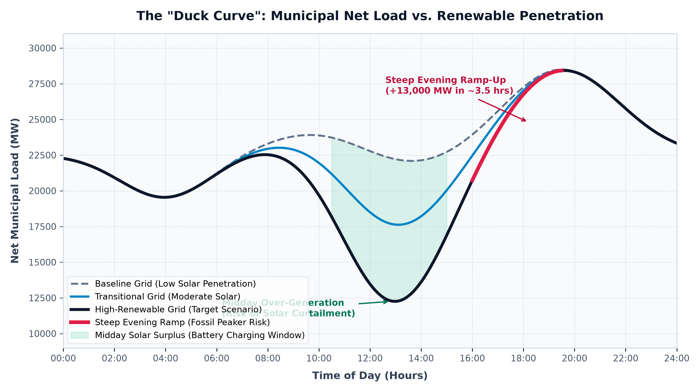

# 1. Vizija i kontekst sistema

> **Pregled poglavlja:** Ovo poglavlje definiše inženjersku motivaciju, apstrakciju domena, matematički model upravljanja resursima, spoljne granice sistema i merljive ključne pokazatelje performansi (KPI) za **EcoSync** platformu.

* [1.1 Definicija problema: Izazov nestabilnosti obnovljivih izvora](#11-definicija-problema-izazov-nestabilnosti-obnovljivih-izvora)
* [1.2 Predloženo rešenje: EcoSync paradigma digitalnog blizanca](#12-predloženo-rešenje-ecosync-paradigma-digitalnog-blizanca)
* [1.3 Makro-model energetskog bilansa i upravljanja resursima](#13-makro-model-energetskog-bilansa-i-upravljanja-resursima)
* [1.4 Kontekst sistema i ekosistem aktera](#14-kontekst-sistema-i-ekosistem-aktera)
* [1.5 Ključni operativni scenariji](#15-ključni-operativni-scenariji)
* [1.6 Arhitektonski opseg i granice domena](#16-arhitektonski-opseg-i-granice-domena)
* [1.7 Ključni pokazatelji performansi i održivosti (KPI)](#17-ključni-pokazatelji-performansi-i-održivosti-kpi)

---

## 1.1 Definicija problema: Izazov nestabilnosti obnovljivih izvora

Savremena gradska energetska infrastruktura suočava se sa suštinskim problemom sinhronizacije tokom prelaska sa centralizovanih termoelektrana na distribuirane obnovljive izvore energije (solarni parkovi i vetroelektrane). Za razliku od konvencionalnih termo-blokova čija se snaga može ručno regulisati prema potrebi, proizvodnja iz obnovljivih izvora je **inherentno stohastička** — uslovljena dnevnim solarnim ciklusima, prolaznom oblačnošću i promenama brzine vetra.

Istovremeno, urbana potrošnja električne energije pokazuje izražene, predvidive bihevioralne vrhove: jutarnji porast industrijskog opterećenja, podnevnu komercijalnu potrošnju i strmi večernji skok potrošnje u domaćinstvima. U energetskoj ekonomiji, ova neusklađenost poznata je kao **fenomen „pačje krive“ (*Duck Curve*)**:

1. **Podnevna hiperprodukcija:** Proizvodnja iz solarnih elektrana dostiže maksimum između 11:00 i 14:00 časova, često nadmašujući trenutnu potrošnju grada i primoravajući operatere da odbacuju (*curtailment*) čistu energiju ukoliko nema slobodnih kapaciteta za skladištenje.
2. **Večernji deficit i nagli uspon opterećenja:** Između 17:00 i 21:00 časa, solarna proizvodnja pada na nulu upravo u trenutku kada potrošnja u domaćinstvima naglo raste, stvarajući akutan energetski deficit.
3. **Oslanjanje na fosilne vršne elektrane:** Kako bi se sprečili ispadi mreže tokom ovog večernjeg skoka, operateri moraju da pokrenu takozvane vršne elektrane (*peaker plants*) na gas ili ugalj. Ovi rezervni kapaciteti su finansijski skupi, spori za sinhronizaciju i odgovorni za nesrazmerno visoku emisiju ugljen-dioksida ($CO_2$).

{width=88%}
*Slika 1.1: „Pačja kriva“ (Duck Curve) koja ilustruje podnevni višak solarne energije i strmi večernji rast neto opterećenja pri različitim nivoima udela obnovljivih izvora. Prilagođeno prema projekcijama CAISO Net Load modela [1].*

Postojeći sistemi za nadzor gradske mreže (tradicionalne SCADA instalacije) pretežno su **reaktivni i pasivni**. Oni prikazuju trenutnu telemetriju, ali im nedostaju protočni cevovodi podataka visokih performansi i prediktivna inteligencija neophodna za proaktivno planiranje rada gradskih baterija *pre* nego što nastupi deficit obnovljive energije.

---

## 1.2 Predloženo rešenje: EcoSync paradigma digitalnog blizanca

**EcoSync** je distribuirani **digitalni blizanac** (*Digital Twin*) i sistem za optimizaciju resursa u realnom vremenu, projektovan da premosti jaz između sirove gradske telemetrije i autonomnih odluka u domenu održivosti.

U sistemskom inženjerstvu, digitalni blizanac se suštinski razlikuje od statičkog kontrolnog panela: on održava **živu, dvosmernu digitalnu repliku** stanja fizičke infrastrukture, kontinuirano prihvata telemetriju u realnom vremenu, izvršava simulacije unapred i šalje preskriptivne planove upravljanja nazad operaterima i automatizovanim aktuatorima.

{width=90%}
*Slika 1.2: Konceptualni 3D prostorni model urbane infrastrukture sistema EcoSync, sa prikazom dinamičkih zona potrošnje, distribuiranih solarnih i vetro klastera i centralnog baterijskog skladišta (ESS).*

Kako bi fokus ostao na distribuiranoj softverskoj arhitekturi umesto na niskonaponskoj elektrotehnici, EcoSync modeluje pametni grad kao **mrežu resursa na makro nivou** sastavljenu od četiri osnovna entiteta:

* **Dinamičke zone potrošnje ($Z_1 \dots Z_n$):** Agregirani stambeni, industrijski i komercijalni gradski distrikti koji u realnom vremenu šalju telemetriju o potražnji snage u megavatima ($MW$).
* **Klasteri obnovljive proizvodnje ($G_{\text{solar}}, G_{\text{wind}}$):** Distribuirani proizvođači zelene energije čiji izlaz varira u skladu sa simuliranim ekološkim i meteorološkim uslovima.
* **Baterijski sistemi za skladištenje energije ($ESS$):** Gradske baterijske banke velikog kapaciteta sposobne da apsorbuju višak zelene energije van vršnih sati i isporuče je tokom večernjih udara potrošnje.
* **Fosilna rezervna jedinica ($G_{\text{fossil}}$):** Rezervni neobnovljivi izvor energije čije angažovanje algoritam optimizacije u sistemu EcoSync aktivno nastoji da svede na minimum.

---

## 1.3 Makro-model energetskog bilansa i upravljanja resursima

Umesto modelovanja trofazne naizmenične struje, padova napona ili reaktivne impedanse, EcoSync formuliše stabilnost mreže kao **diskretni problem očuvanja energije i minimizacije ugljeničnog otiska** koji se evaluira u fiksnim vremenskim koracima $\Delta t$. Pri balansiranju mreže primenjuje se stroga hijerarhija prioriteta (*Merit Order*): celokupna raspoloživa obnovljiva energija ($G_{\text{solar}}, G_{\text{wind}}$) troši se prva, baterijski sistem ($ESS$) služi kao glavna upravljiva poluga za premošćavanje vremenskih neusklađenosti, dok se fosilna rezervna jedinica ($G_{\text{fossil}}$) aktivira isključivo kao poslednja instanca za pokrivanje preostalog deficita.

### 1.3.1 Trenutni bilans snage
U svakom diskretnom vremenskom trenutku $t$, ukupna gradska potražnja $P_{\text{demand}}(t)$ kroz $N$ gradskih zona mora biti zadovoljena zbirom obnovljive proizvodnje, neto pražnjenja baterija i dopunske proizvodnje iz fosilnih rezervi:

$$P_{\text{demand}}(t) = \sum_{i=1}^{N} P_{\text{zone}, i}(t)$$

$$P_{\text{supply}}(t) = P_{\text{solar}}(t) + P_{\text{wind}}(t) + P_{\text{bat, dis}}(t) - P_{\text{bat, chg}}(t) + P_{\text{fossil}}(t)$$

Da bi gradska mreža ostala stabilna bez redukcija potrošnje, sistem nameće osnovno ograničenje energetske ravnoteže:

$$P_{\text{supply}}(t) \ge P_{\text{demand}}(t), \quad \forall t \in \{1, \dots, T\}$$

### 1.3.2 Dinamika napunjenosti baterija ($SoC$)
Gradski sistem za skladištenje energije poseduje maksimalni energetski kapacitet $E_{\max}$ (izražen u $MWh$) i stanje napunjenosti $SoC(t) \in [SoC_{\min}, SoC_{\max}]$ (tipično ograničeno između $15\%$ i $95\%$ radi sprečavanja degradacije ćelija). Uzimajući u obzir stepen iskorišćenja pri punjenju $\eta_{\text{chg}}$ i pražnjenju $\eta_{\text{dis}}$, energetsko stanje baterije evoluira prema relaciji:

$$SoC(t + \Delta t) = SoC(t) + \frac{\eta_{\text{chg}} \cdot P_{\text{bat, chg}}(t) \cdot \Delta t}{E_{\max}} - \frac{P_{\text{bat, dis}}(t) \cdot \Delta t}{\eta_{\text{dis}} \cdot E_{\max}}$$

### 1.3.3 Funkcija cilja emisije ugljen-dioksida
Svaki megavat-sat proizveden iz fosilne rezervne jedinice nosi penal intenziteta ugljenika $\gamma_{CO_2}$ (izražen u $\text{kg } CO_2 / MWh$). AI optimizacioni sloj platforme EcoSync (Faza 3) kontinuirano izračunava putanje punjenja i pražnjenja baterija koje minimizuju kumulativnu emisiju na horizontu predikcije $H$:

$$\min \sum_{t=1}^{H} \left( \gamma_{CO_2} \cdot P_{\text{fossil}}(t) \cdot \Delta t \right)$$

### 1.3.4 Strukturna dekompozicija optimizacionog modela (Ulazi, Parametri i Izlazi)
Sa aspekta softverske implementacije u Fazi 3, matematički model se izvršava kao optimizacioni modul linearnog programiranja (*Linear Programming Solver*). Na osnovu fiksnih parametara infrastrukture i dinamičkih ulaznih vektora (trenutne telemetrije i ML prognoze za horizont $H$), solver izračunava optimalne upravljačke odluke za svaki naredni vremenski korak.

{width=92%}
*Slika 1.3: Blok-šema matematičkog modela optimizacije sa prikazom fiksnih sistemskih parametara, dinamičkih ulaza i izlaznih upravljačkih odluka.*

#### A. Dinamički ulazi (Inputs)
Ulazni podaci predstavljaju promenljive veličine koje u sistem pristižu iz IoT edge simulatora (trenutno stanje) i modula mašinskog učenja (prognozirane vrednosti za narednih $H$ koraka):

| Oznaka | Naziv promenljive | Jedinica | Izvor podataka | Uloga u modelu |
| :--- | :--- | :--- | :--- | :--- |
| $P_{\text{zone}, i}(t)$ | Potrošnja po gradskim zonama ($i=1\dots N$) | $MW$ | MQTT / ML prognoza | Sabira se u ukupnu potražnju grada $P_{\text{demand}}(t)$ koju sistem mora da zadovolji. |
| $P_{\text{solar}}(t)$ | Proizvodnja solarnih parkova | $MW$ | MQTT / Vremenska prognoza | Nekontrolisani zeleni ulaz; uvek ima apsolutni prioritet potrošnje. |
| $P_{\text{wind}}(t)$ | Proizvodnja vetroelektrana | $MW$ | MQTT / Vremenska prognoza | Nekontrolisani zeleni ulaz; uvek ima apsolutni prioritet potrošnje. |
| $SoC(0)$ | Trenutna napunjenost baterije | $\%$ ($0-1$) | Redis (BMS telemetrija) | Početni granični uslov od kog započinje proračun trajektorije baterije. |

#### B. Sistemski parametri (Parameters)
Parametri definišu fizička ograničenja i karakteristike virtuelne gradske infrastrukture. Ostaju konstantni tokom pojedinačnog ciklusa optimizacije i čuvaju se u konfiguraciji sistema:

| Oznaka | Naziv parametra | Referentna vrednost | Inženjersko značenje |
| :--- | :--- | :--- | :--- |
| $E_{\max}$ | Nominalni kapacitet baterije | $500\text{ MWh}$ | Maksimalna količina energije koju gradsko ESS skladište može da primi. |
| $P_{\text{bat, max}}$ | Maksimalna snaga punjenja/pražnjenja | $125\text{ MW}$ | Gornja granica protoka snage u jednom satu uslovljena kapacitetom invertora. |
| $SoC_{\min}, SoC_{\max}$ | Sigurnosne granice napunjenosti | $0,15$ i $0,95$ | Donji i gornji prag rada baterije radi sprečavanja ubrzane degradacije ćelija. |
| $\eta_{\text{chg}}, \eta_{\text{dis}}$ | Stepen iskorišćenja ciklusa | $0,95$ ($95\%$) | Koeficijenti gubitaka energije prilikom konverzije i skladištenja u bateriji. |
| $\gamma_{CO_2}$ | Emisioni faktor fosilne rezerve | $450\text{ kg/MWh}$ | Specifična emisija ugljen-dioksida po megavat-satu proizvedenom iz fosilnih rezervi. |
| $\Delta t$ i $H$ | Vremenski korak i horizont | $\Delta t = 1\text{ h}$, $H = 24$ | Rezolucija diskretizacije i dužina vremenskog prozora za koji se planira raspored. |

#### C. Upravljački izlazi (Outputs / Decision Variables)
Izlazi predstavljaju nepoznate promenljive odlučivanja koje algoritam linearnog programiranja pronalazi tako da funkcija cilja dostigne globalni minimum:

| Oznaka | Naziv izlazne promenljive | Jedinica | Odredište i primena |
| :--- | :--- | :--- | :--- |
| $P_{\text{bat, chg}}(t)$ | Optimalna snaga punjenja baterije | $MW$ | Šalje se C# jezgru i SCADA konzoli kao nalog za akumulaciju viška zelene energije. |
| $P_{\text{bat, dis}}(t)$ | Optimalna snaga pražnjenja baterije | $MW$ | Šalje se C# jezgru i SCADA konzoli kao nalog za pokrivanje vršnog opterećenja. |
| $P_{\text{fossil}}(t)$ | Potrebna snaga fosilne rezerve | $MW$ | Definiše preostali deficit koji mora pokriti rezervna jedinica (teži ka $0\text{ MW}$). |
| $SoC(t)$ i $E_{CO_2}$ | Očekivana putanja i emisija | $\%$ i $\text{kg}$ | Izvedene metrike za vizuelizaciju predviđenog stanja baterije i uštede $CO_2$. |

---

## 1.4 Kontekst sistema i ekosistem aktera

Prateći **C4 arhitektonski model (Nivo 1 — Kontekst sistema)**, EcoSync deluje kao centralni nervni sistem koji povezuje proizvođače edge telemetrije, analitičke servise i ljudske donosioce odluka.

{width=92%}
*Slika 1.4: C4 dijagram konteksta sistema (Nivo 1) sa prikazom spoljnih izvora podataka, centralne platforme EcoSync i krajnjih korisnika.*

### Specifikacija aktera i spoljnih sistema

| Akter / Spoljni sistem | Kategorija | Primarna odgovornost i interakcija |
| :--- | :--- | :--- |
| **IoT Edge klaster senzora** | Spoljni sistem | Strimuje telemetriju visoke učestanosti (500 ms) o gradskoj potrošnji, proizvodnji obnovljivih izvora i $SoC\%$ baterija putem MQTT protokola. |
| **Dispečer kontrolnog centra** | Primarni korisnik | Nadgleda tokove energije u realnom vremenu, raspodelu opterećenja po zonama i AI preporuke putem tamne SCADA web konzole. |
| **Gradski menadžer održivosti** | Izvršni korisnik | Prima push alarme tokom kritičnih deficita zelene energije na mobilnoj aplikaciji i autorizuje aktivaciju rezervnih kapaciteta. |
| **Meteorološki i tarifni servis** | Spoljni izvor | Dostavlja kratkoročne vremenske prognoze (oblačnost, brzina vetra) koje ML model koristi za predviđanje padova proizvodnje. |

---

## 1.5 Ključni operativni scenariji

Kako bi se validiralo ponašanje sistema u realističnim gradskim uslovima, EcoSync je projektovan oko tri primarna operativna toka:

### Scenario A: Podnevni višak obnovljive energije (Automatizovana arbitraža baterija)
* **Okidač:** Visoko sunčevo zračenje dovodi do stanja $P_{\text{solar}}(t) + P_{\text{wind}}(t) > P_{\text{demand}}(t)$ dok je napunjenost baterija $SoC(t) < 85\%$.
* **Ponašanje sistema:** C# servis za prijem podataka u realnom vremenu detektuje pozitivan neto bilans zelene energije. AI optimizator izdaje nalog ESS sistemu da apsorbuje višak snage ($P_{\text{bat, chg}} > 0$), skladišteći energiju bez emisije $CO_2$ umesto odbacivanja viška solarne proizvodnje.

### Scenario B: Iznenadna promena vremenskih prilika (Podsekundni prelaz na rezervu)
* **Okidač:** Gusti oblaci naglo smanjuju solarnu proizvodnju za $60\%$ u roku od 30 sekundi tokom popodnevnog industrijskog špica.
* **Ponašanje sistema:** Edge senzori publikuju telemetriju naglog pada snage preko MQTT brokera. U roku od nekoliko milisekundi, C# jezgro ažurira stanje u Redis kešu, šalje upozorenje putem SignalR kanala na SCADA dashboard i aktivira pražnjenje baterija ($P_{\text{bat, dis}} > 0$) kako bi se premostio manjak bez paljenja fosilnih agregata.

### Scenario C: Prediktivno peglanje večernjeg vršnog opterećenja (Peak Shaving)
* **Okidač:** Modeli istorijske potrošnje predviđaju porast potrošnje u domaćinstvima od $+35\%$ u 19:00 časova usled ekstremnih večernjih temperatura, dok prognoza vetra ukazuje na tiho vreme bez vetra.
* **Ponašanje sistema:** Dva sata pre očekivanog udara, Python ML model predviđa predstojeći deficit. Algoritam linearnog programiranja izračunava optimalan raspored dopunjavanja baterija, obezbeđujući da kapacitet dostigne $95\%\text{ }SoC$ pre 18:30 kako bi večernji vrh bio apsorbovan iz uskladištene energije.

---

## 1.6 Arhitektonski opseg i granice domena

Postavljanje jasnih inženjerskih granica osigurava da fokus razvoja ostane usmeren na distribuirane softverske sisteme, inženjering podataka i algoritamsku optimizaciju:

| U opsegu projekta (Softversko i sistemsko inženjerstvo) | Van opsega projekta (Fizički hardver i elektrotehnika) |
| :--- | :--- |
| Energetski bilans grada na makro nivou ($MW$ i $MWh$) | Fizika trofaznog naizmeničnog/jednosmernog napona i reaktivne snage |
| Prijem MQTT telemetrije visokog protoka i binarna Protobuf serijalizacija | Fizičko ožičenje PLC kontrolera i rasklopna postrojenja u trafostanicama |
| Vruća/hladna putanja podataka (Redis keš + TimescaleDB hipertabele) | Termička dinamika namotaja transformatora i elektromagnetno modelovanje |
| ML prognoza opterećenja i linearno programiranje (minimizacija $CO_2$) | Elektrohemijska fizika degradacije baterijskih ćelija |
| Real-time WebSockets (SignalR), k6 haos testiranje i Terraform IaC | Regulativa obračuna električne energije i zakonsko tarifiranje |

---

## 1.7 Ključni pokazatelji performansi i održivosti (KPI)

Uspešnost sistema meri se konkretnim, ponovljivim metrikama koje su dokumentovane u poglavljima posvećenim testiranju performansi i otpornosti ovog dokumenta:

| Kategorija metrike | Indikator | Ciljana vrednost | Metod verifikacije |
| :--- | :--- | :--- | :--- |
| **Propusna moć (Throughput)** | Održivi prijem telemetrije | $\ge 10.000\text{ poruka/sek}$ | k6 distribuirana simulacija opterećenja (Faza 6) |
| **Latencija** | Ukupno vreme obrade (MQTT $\rightarrow$ Redis) | $< 15\text{ ms}$ ($p99$ latencija) | Prometheus i Grafana telemetrijski histogrami |
| **Dostupnost** | Oporavak nakon pada brokera | $< 3\text{ sekunde}$ (auto-reconnect) | Chaos testovi gašenja kontejnera (`docker kill`) |
| **Tačnost AI modela** | Greška kratkoročne prognoze opterećenja | $\text{MAPE} < 5,0\%$ | Scikit-learn unakrsna validacija na test skupu |
| **Održivost** | Smanjenje rada fosilnih rezervi | $18\% - 25\%$ redukcija $CO_2$ | Komparativna simulacija: AI naspram bazne mreže |

\newpage