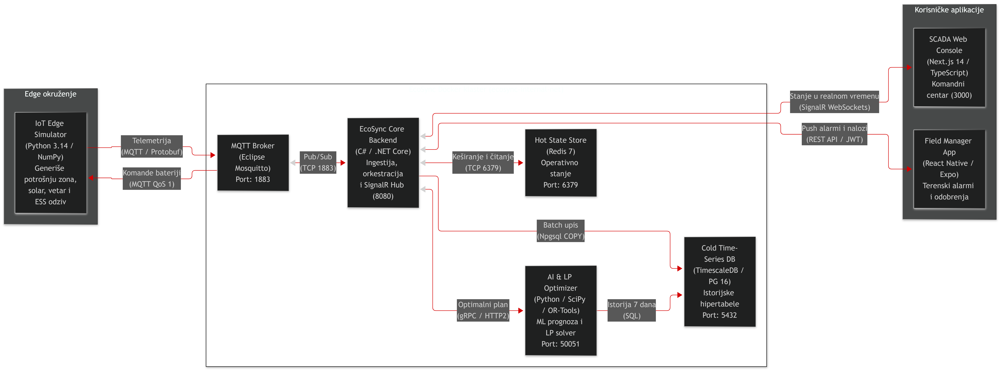
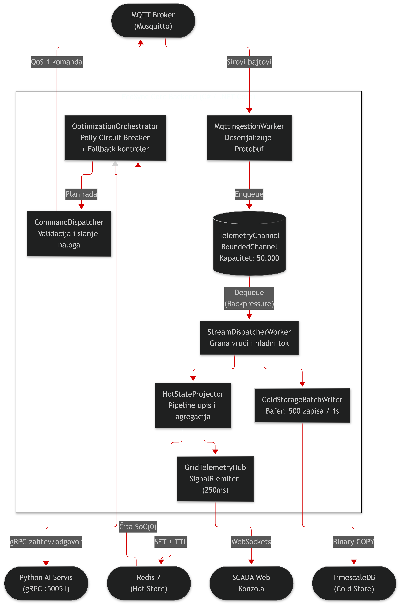
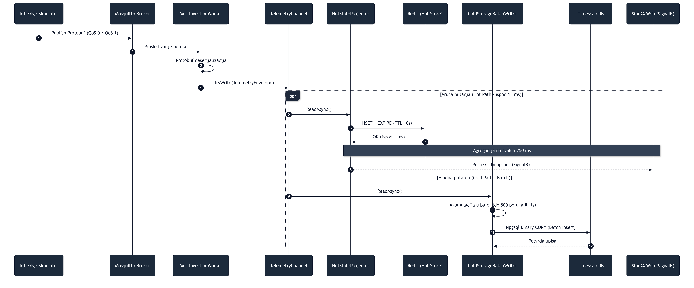
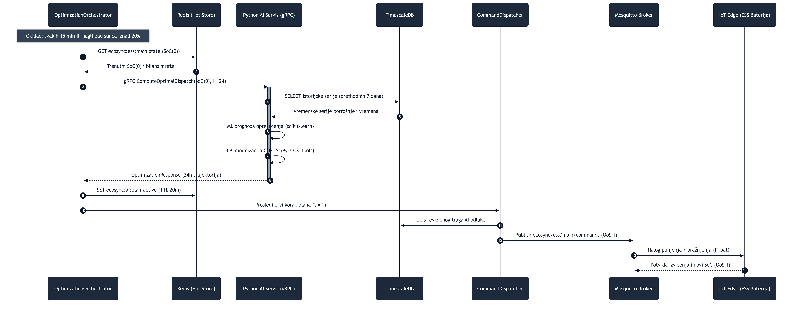

# 2. Arhitektura sistema

> **Pregled poglavlja:** Ovo poglavlje definiše softversku arhitekturu platforme **EcoSync** kroz C4 model (Nivo 2 — Kontejneri i Nivo 3 — Komponente), specifikaciju mrežnih protokola i strukture podataka, dinamičke tokove obrade telemetrije i zatvorene petlje upravljanja, mehanizme samo-oporavka (*Self-Healing*), mrežnu bezbednost i registar arhitektonskih odluka (ADR).

- [2.1 Hibridni arhitektonski stil i principi projektovanja](#21-hibridni-arhitektonski-stil-i-principi-projektovanja)
- [2.2 C4 Nivo 2: Kontejnerska arhitektura i komunikaciona matrica](#22-c4-nivo-2-kontejnerska-arhitektura-i-komunikaciona-matrica)
- [2.3 C4 Nivo 3: Unutrašnja struktura C# jezgra (Core Backend)](#23-c4-nivo-3-unutrašnja-struktura-c-jezgra-core-backend)
- [2.4 Dinamički tokovi podataka i kontrolne petlje](#24-dinamički-tokovi-podataka-i-kontrolne-petlje)
- [2.5 Arhitektura otpornosti i samo-oporavka (Resilience i Self-Healing)](#25-arhitektura-otpornosti-i-samo-oporavka-resilience-i-self-healing)
- [2.6 Mrežna izolacija, kontrola pristupa i bezbednost](#26-mrežna-izolacija-kontrola-pristupa-i-bezbednost)
- [2.7 Registar arhitektonskih odluka (ADR)](#27-registar-arhitektonskih-odluka-adr)

---

## 2.1 Hibridni arhitektonski stil i principi projektovanja

Zahtev za istovremenim prijemom preko $10.000$ telemetrijskih poruka u sekundi uz $p99$ latenciju obrade ispod $15\text{ ms}$ i izvršavanjem kompleksnih optimizacionih proračuna isključuje primenu uniformnog arhitektonskog obrasca. Umesto klasične CRUD mikroservisne topologije, **EcoSync** primenjuje **hibridnu arhitekturu** zasnovanu na tri komplementarna stila:

1. **Događajima vođena arhitektura (*Event-Driven / Pub-Sub*) na ivici mreže:** IoT senzori gradskih zona i baterijskih sistema asinhrono publikuju telemetrijske događaje putem MQTT brokera bez čekanja na potvrdu upisa u trajno skladište, čime se proizvođači signala potpuno razdvajaju od potrošača [4].
2. **Protočni cevovodi (*Pipes-and-Filters / Producer-Consumer*) u jezgru:** Centralni C# servis odvaja brzi mrežni prijem paketa od sporijih I/O operacija pomoću ograničenih memorijskih kanala (*Bounded Channels*) i grana tok podataka na **vruću putanju** (operativno stanje u memoriji) i **hladnu putanju** (grupni upis vremenskih serija na disk).
3. **Sinhroni RPC i dvosmerni Push na aplikativnom sloju:** Komunikacija između C# orkestratora i izolovanog Python AI servisa odvija se preko niskolatentnog binarnog **gRPC** protokola, dok se vizuelizacija na SCADA komandnom centru osvežava putem trajnih **SignalR** WebSocket sesija.

Arhitektura se oslanja na sledeća četiri inženjerska principa:
* **Ugovor pre koda (*Contract-First*):** Svi telemetrijski paketi i međuservisni pozivi strogo su definisani u `.proto` (Protocol Buffers) šemama, čime se eliminišu greške parsiranja između Python i C# servisa.
* **Razdvajanje operativnog stanja od istorije (*Hot/Cold Separation*):** Operativni upiti nad trenutnim stanjem mreže nikada ne pogađaju relacionu bazu na disku, već se opslužuju isključivo iz RAM memorije.
* **Projektovanje za otkaz (*Design for Failure*):** Svaka spoljašnja zavisnost (broker, keš, baza, AI servis) smatra se podložnom privremenom prekidu i zaštićena je prekidačima kola, baferima i rezervnim algoritmima upravljanja.
* **Kontrola sa klizećim horizontom (*Receding Horizon Control*):** Optimizacioni model računa raspored rada baterija za narednih $H = 24$ koraka, ali izvršava isključivo prvi naredni korak i ponovo pokreće proračun po pristizanju novih merenja [6, 7].

---

## 2.2 C4 Nivo 2: Kontejnerska arhitektura i komunikaciona matrica

Spuštanjem pogleda sa nivoa konteksta (Slika 1.4) na **C4 Nivo 2 (Dijagram kontejnera)** [8], platforma EcoSync se dekomponuje na osam samostalnih izvršnih jedinica orkestriranih unutar Docker okruženja.

{width=94%}
*Slika 2.1: C4 dijagram kontejnera (Nivo 2) sa prikazom izvršnih servisa, skladišta podataka, mrežnih protokola i smerova toka telemetrije i upravljačkih komandi.*

### 2.2.1 Specifikacija kontejnera i odgovornosti

| Kontejner / Servis | Tehnološki stek | Interni port | Primarna arhitektonska odgovornost |
| :--- | :--- | :--- | :--- |
| **IoT Edge Simulator** | Python 3.14, `NumPy`, `paho-mqtt`, `Protobuf` | — *(odlazni)* | Generiše realističnu telemetriju potrošnje zona, solarnih/vetro klastera i simulira fizički odziv ESS baterija na primljene komande. |
| **MQTT Broker** | Eclipse Mosquitto 2.x | `1883` (TCP) | Centralni razvodnik poruka; rutira binarnu telemetriju ka jezgru i prosleđuje upravljačke naloge nazad ka baterijskim aktuatorima. |
| **EcoSync Core Backend** | C# / .NET Core, `MQTTnet`, `SignalR`, `Polly` | `8080` (HTTP/WS) | Centralni orkestrator; vrši ingestiju telemetrije, održava vruće/hladno stanje, upravlja otpornošću i izlaže REST i SignalR interfejse. |
| **Hot State Store** | Redis 7 (In-Memory) | `6379` (TCP) | Čuva isključivo poslednju poznatu telemetriju zona i stanje baterije ($SoC$) sa `TTL` istekom za očitavanje u vremenu $< 1\text{ ms}$. |
| **Cold Time-Series DB** | PostgreSQL 16 + TimescaleDB | `5432` (TCP) | Trajno skladište istorijskih merenja, prognoza i AI odluka organizovano u automatski particionisane hipertabele (*hypertables*). |
| **AI & LP Optimizer** | Python 3.14, `gRPC`, `scikit-learn`, `SciPy`/`OR-Tools` | `50051` (gRPC) | Izvršava kratkoročnu ML prognozu potrošnje i rešava problem linearnog programiranja za minimizaciju emisije $CO_2$. |
| **SCADA Web Console** | Next.js 14, React, TypeScript, Tailwind CSS | `3000` (HTTP) | Operaterski komandni centar visoke gustine informacija sa vizuelizacijom tokova snage i AI preporuka u realnom vremenu. |
| **Field Manager App** | React Native (Expo), TypeScript | — *(klijent)* | Mobilni interfejs za prijem kritičnih push alarma i autorizaciju aktivacije fosilnih rezervnih kapaciteta. |

### 2.2.2 Hijerarhija MQTT tema i nivoi garancije isporuke (QoS)

Komunikacija preko Mosquitto brokera strukturisana je hijerarhijski kako bi se omogućila selektivna pretplata pomoću MQTT džokera (`+` za pojedinačni nivo, `#` za podstablo) i diferencirani nivo kvaliteta usluge (*Quality of Service*):

| Šablon MQTT teme | Smer toka | Payload format | QoS | Obrazloženje izbora QoS nivoa |
| :--- | :--- | :--- | :--- | :--- |
| `ecosync/zones/{zoneId}/telemetry` | Edge $\rightarrow$ Core | Protobuf (`ZoneTelemetry`) | `QoS 0` | Visokofrekventna telemetrija ($500\text{ ms}$); gubitak pojedinačnog paketa je prihvatljiv jer odmah stiže sledeće merenje, bez mrežnog *overhead*-a potvrde. |
| `ecosync/renewables/{type}/telemetry` | Edge $\rightarrow$ Core | Protobuf (`GenerationTelemetry`) | `QoS 0` | Kontinuirani podaci o snazi solarnih i vetro klastera ($MW$); prioritet je minimalna latencija prijema. |
| `ecosync/ess/{unitId}/state` | Edge $\rightarrow$ Core | Protobuf (`BatteryState`) | `QoS 1` | Kritično stanje napunjenosti baterije ($SoC\%$) i temperatura ćelija; zahteva garanciju isporuke najmanje jednom (*At Least Once*). |
| `ecosync/ess/{unitId}/commands` | Core $\rightarrow$ Edge | Protobuf (`DispatchCommand`) | `QoS 1` | Upravljački nalozi za punjenje/pražnjenje baterija ($P_{\text{bat, chg}}$, $P_{\text{bat, dis}}$); ne smeju biti izgubljeni u prenosu. |
| `ecosync/devices/{deviceId}/status` | Broker $\rightarrow$ Core | Protobuf (`DeviceStatus`) | `QoS 1` | MQTT *Last Will and Testament (LWT)* sa `Retained` flegom za trenutnu detekciju prekida veze sa terenskim čvorom. |

### 2.2.3 Struktura ključeva u Redis kešu (Hot State Schema)

Kako bi se sprečilo nagomilavanje zastarelih podataka u slučaju otkaza senzora, svi operativni ključevi u Redisu poseduju strogo definisano vreme trajanja (`TTL`):

| Obrazac ključa u Redisu | Tip strukture | TTL | Sadržaj i svrha |
| :--- | :--- | :--- | :--- |
| `ecosync:zone:{zoneId}:latest` | Hash / Binary | `10 s` | Poslednja izmerena aktivna snaga ($MW$) i vremenska oznaka (*timestamp*) gradske zone. |
| `ecosync:grid:aggregate` | Hash | `5 s` | Trenutni zbirni bilans mreže: $P_{\text{demand}}$, $P_{\text{solar}}$, $P_{\text{wind}}$, neto opterećenje i trenutna emisija $CO_2$. |
| `ecosync:ess:main:state` | Hash | `15 s` | Trenutni $SoC(t)$, režim rada (`CHARGING`, `DISCHARGING`, `IDLE`) i raspoloživi kapacitet ($MWh$). |
| `ecosync:ai:plan:active` | String (JSON/Proto) | `20 min` | Aktivni 24-časovni plan rada baterija dobijen iz poslednjeg ciklusa LP optimizacije. |

---

## 2.3 C4 Nivo 3: Unutrašnja struktura C# jezgra (Core Backend)

Unutar kontejnera **EcoSync Core Backend**, poslovna logika je podeljena na jasno razgraničene komponente (**C4 Nivo 3 — Dijagram komponenti**) [8] koje izvršavaju pozadinske radnike (*Background Services*) i koordiniraju tok podataka bez međusobnog blokiranja niti.

{width=94%}
*Slika 2.2: C4 dijagram komponenti (Nivo 3) unutar .NET Core jezgra sa prikazom memorijskog kanala za kontrolu zagušenja, paralelnih putanja skladištenja i orkestratora optimizacije.*

### Pregled internih modula .NET Core servisa

* **`MqttIngestionWorker`:** Pozadinski servis zasnovan na biblioteci `MQTTnet`. Održava trajnu TCP sesiju sa Mosquitto brokerom, prima sirove nizove bajtova, deserijalizuje ih pomoću `Google.Protobuf` parsera i bez ikakve poslovne obrade prosleđuje objekat u memorijski kanal.
* **`TelemetryChannel` (`BoundedChannel<TelemetryEnvelope>`):** Centralni red čekanja u RAM memoriji kapaciteta $50.000$ poruka (`SingleWriter = false`, `SingleReader = false`). Služi kao amortizer iznenadnih skokova saobraćaja (*burst absorber*) i mehanizam kontrole pritiska podataka (*backpressure*).
* **`StreamDispatcherWorker`:** Čita pristigle poruke iz `TelemetryChannel` reda i prosleđuje ih paralelno na dva nezavisna toka: operativnu projekciju stanja i bafer za istorijski upis.
* **`HotStateProjector`:** Ažurira ključeve u Redisu putem `StackExchange.Redis` pipeline komandi i održava interni tajmer za agregaciju stanja (svakih $250\text{ ms}$), nakon čega emituje paketno ažuriranje preko `GridTelemetryHub` (`SignalR`) klase svim povezanim SCADA klijentima. Time se sprečava preopterećenje mreže i pregledača dispečera pri frekvenciji od $10.000\text{ poruka/s}$.
* **`ColdStorageBatchWriter`:** Akumulira telemetrijske zapise u lokalnom nizu dok se ne ispuni jedan od dva uslova: dostignuto $500$ zapisa ili protekla $1\text{ sekunda}$ od poslednjeg upisa. Zatim izvršava masovni binarni upis (`NpgsqlBinaryImporter` / PostgreSQL `COPY`) u TimescaleDB hipertabelu `telemetry_metrics`, smanjujući broj mrežnih transakcija ka bazi za dva reda veličine.
* **`OptimizationOrchestrator`:** Periodični i događajima okidani koordinator. Na svakih $15\text{ minuta}$ — ili odmah kada detektuje nagli pad obnovljive proizvodnje veći od $20\%$ u roku od $30\text{ sekundi}$ (Scenario B iz poglavlja 1.5) — preuzima trenutni $SoC(0)$ iz Redisa i poziva Python AI servis preko gRPC klijenta.
* **`CommandDispatcher`:** Validira dobijeni optimalni vektor snaga ($P_{\text{bat, chg}}, P_{\text{bat, dis}}$) u odnosu na sigurnosne granice opreme, upisuje revizioni trag odluke u bazu i publikuje binarnu komandu na MQTT temu `ecosync/ess/main/commands` sa `QoS 1` garancijom.

---

## 2.4 Dinamički tokovi podataka i kontrolne petlje

### 2.4.1 Tok prijema i obrade telemetrije (Hot & Cold Path)

Dijagram sekvence na Slici 2.3 ilustruje životni ciklus jednog telemetrijskog paketa od trenutka generisanja na IoT simulatoru do prikaza na ekranu dispečera i trajnog skladištenja.

{width=92%}
*Slika 2.3: Dijagram sekvence asinhronog prijema telemetrije sa paralelnim grananjem na vruću (Redis/SignalR) i hladnu (TimescaleDB batch) putanju.*

Ključna karakteristika ovog toka je da su **vreme obrade do Redisa ($< 15\text{ ms}$) i upis u TimescaleDB potpuno asinhroni**. Evenutalno usporavanje diska prilikom upisa u TimescaleDB ne zadržava niti koje osvežavaju Redis keš i SCADA ekran.

### 2.4.2 Zatvorena petlja prediktivne optimizacije (Closed-Loop Control)

Dijagram sekvence na Slici 2.4 prikazuje izvršavanje kontrolne petlje optimizacije između C# orkestratora, Python AI/LP mikroservisa i baterijskog sistema.

{width=92%}
*Slika 2.4: Dijagram sekvence ciklusa prediktivne optimizacije sa gRPC pozivom, ML prognozom opterećenja, LP rešavanjem i slanjem komande baterijskom sistemu.*

Sekvenca se odvija u pet koraka:
1. `OptimizationOrchestrator` očitava trenutno stanje napunjenosti baterije $SoC(0)$ i tekuću proizvodnju iz Redisa.
2. Putem gRPC metode `ComputeOptimalDispatch(OptimizationRequest)` šalje trenutne parametre i dužinu horizonta ($H = 24$, $\Delta t = 1\text{ h}$) Python servisu.
3. Python servis povlači istorijske serije potrošnje i meteoroloških uslova za prethodnih $7\text{ dana}$ iz TimescaleDB-a, pokreće regresioni ML model (`scikit-learn`) i generiše vektore prognoze $\hat{P}_{\text{demand}}(t)$, $\hat{P}_{\text{solar}}(t)$ i $\hat{P}_{\text{wind}}(t)$.
4. Dobijeni vektori se prosleđuju solveru linearnog programiranja (`SciPy` / `Google OR-Tools`), koji pronalazi globalni minimum funkcije cilja emisije $CO_2$ uz poštovanje ograničenja bilansa snage i dinamike baterije (jednačine iz poglavlja 1.3).
5. Python vraća `OptimizationResponse` sa kompletnom 24-časovnom trajektorijom; C# kešira ceo plan u Redis za prikaz na SCADA grafikonu, a prvi korak plana odmah šalje kao izvršni nalog na MQTT broker.

---

## 2.5 Arhitektura otpornosti i samo-oporavka (Resilience i Self-Healing)

Distribuirani sistemi u energetskoj infrastrukturi ne smeju prekinuti rad usled privremenog zagušenja mreže ili pada pojedinačnog pomoćnog servisa. EcoSync implementira višeslojnu strategiju otpornosti zasnovanu na biblioteci **`Polly`** u .NET Core okruženju:

| Zaštićena zavisnost | Primenjeni obrazac otpornosti | Parametri politike | Ponašanje sistema pri otkazu (Self-Healing) |
| :--- | :--- | :--- | :--- |
| **Python AI gRPC servis** | `Circuit Breaker` + `Timeout` + `Fallback` | Timeout: $2,0\text{ s}$; otvaranje nakon $3$ uzastopne greške; pauza: $30\text{ s}$ | Prekidač prelazi u stanje `Open` i C# automatski aktivira lokalni deterministički **Fallback kontroler** (punjenje pri višku zelene energije, pražnjenje pri deficitu) dok se AI servis ne oporavi. |
| **TimescaleDB (Cold Path)** | `Retry` sa eksponencijalnim čekanjem i *Jitter*-om | $4$ pokušaja ($100\text{ ms}, 250\text{ ms}, 500\text{ ms}, 1\text{ s}$ + nasumični pomak) | Neuspeli paket ostaje u memoriji radnika i ponovo se šalje nakon kratke pauze; *jitter* sprečava istovremeni udar više niti po oporavku baze. |
| **TelemetryChannel bafer** | `BoundedCapacity` + `DropOldest` politika | Kapacitet: $50.000$ poruka u RAM-u | Ako baza ostane nedostupna duže od $5\text{ sekundi}$, bafer amortizuje dolazni saobraćaj, a po popunjavanju odbacuje najstarije `QoS 0` poruke čuvajući stabilnost memorije procesa. |
| **Mosquitto MQTT Broker** | Automatska re-konekcija sa obnovom pretplata | Eksponencijalni interval ($0,5\text{ s}$ do maksimalno $5\text{ s}$) | `MQTTnet` klijent detektuje prekid TCP soketa, obnavlja konekciju i automatski ponovo registruje sve teme u roku ispod $3\text{ sekunde}$ (KPI cilj). |
| **Docker orkestracija** | Kontejnerski *Healthchecks* i restart politika | `restart: unless-stopped`, provera stanja na $5\text{ s}$ | Svaki srušeni kontejner se automatski ponovo pokreće od strane Docker demona bez ljudske intervencije. |

---

## 2.6 Mrežna izolacija, kontrola pristupa i bezbednost

Infrastruktura platforme EcoSync projektovana je prema principu **najmanjih privilegija (*Least Privilege*)** i mrežne segmentacije na nivou kontejnerske topologije:

* **Segmentacija Docker mreža:** Okruženje je podeljeno na dve izolovane virtuelne mreže:
  * `ecosync-internal-net` (interna magistrala bez izlaza ka spoljašnjem svetu): Na njoj se nalaze `Mosquitto`, `Redis`, `TimescaleDB` i `Python AI gRPC` servis. Nijedan od ovih kontejnera nema mapirane portove ka host mašini, čime se eliminiše direktan spoljašnji pristup bazama i brokeru.
  * `ecosync-edge-net` (ulazni sloj): Povezuje isključivo `Next.js SCADA konzolu` i API ulaz `C# Core Backend` servisa sa klijentskim uređajima.
* **Autentifikacija i autorizacija po ulogama (JWT RBAC):** Pristup REST krajnjim tačkama i SignalR čvorištu zaštićen je potpisanim `JWT` (*JSON Web Token*) tokenima sa definisanim ulogama:
  * `Dispatcher` (Dispečer): Pravo čitanja telemetrije u realnom vremenu, pregleda AI prognoza i potvrde alarma.
  * `SustainabilityManager` (Menadžer održivosti): Sva prava dispečera uz ekskluzivno pravo ručnog odobravanja aktivacije fosilnih rezervnih kapaciteta (`POST /api/v1/grid/fossil-override`).
* **Zaštita od preopterećenja i validacija ulaza:** ASP.NET Core `Rate Limiting` ograničava broj zahteva po klijentu (npr. $100\text{ zahteva/min}$ po IP adresi za REST API), dok binarni Protobuf parser automatski odbacuje neispravno formatirane pakete pre ulaska u memorijski kanal.

---

## 2.7 Registar arhitektonskih odluka (ADR)

Sve ključne strukturne odluke dokumentovane su kroz zapise arhitektonskih odluka (*Architecture Decision Records*) sa jasnim obrazloženjem razmotrenih alternativa i kompromisa.

### ADR-001: Izbor MQTT protokola i .NET Channels bafera umesto Apache Kafke
* **Status:** Prihvaćeno
* **Kontekst:** Sistem mora da obrađuje preko $10.000\text{ poruka/sek}$ sa IoT ivice mreže uz $p99$ latenciju ispod $15\text{ ms}$ i minimalno zauzeće resursa u kontejnerskom okruženju.
* **Odluka:** Za prijem telemetrije sa terena koristi se **Eclipse Mosquitto (MQTT)** sa binarnom **Protobuf** serijalizacijom, dok se za kontrolu zagušenja unutar C# jezgra koristi ugrađeni **`System.Threading.Channels` (`BoundedChannel`)**.
* **Razmotrene alternative:** *Apache Kafka* — odbačena za trenutni obim sistema jer ne podržava IoT mehanizme na nivou pojedinačnog uređaja (*Last Will and Testament*, *retained* poruke, hijerarhijske teme), uvodi dodatni mrežni skok i zahteva više gigabajta RAM-a za JVM okruženje.
* **Posledice:** Sub-millisecond prosleđivanje stanja u Redis keš i izuzetno mali memorijski otisak brokera ($\approx 40\text{ MB}$). Ograničenje je odsustvo trajnog distribuiranog loga za nezavisno premotavanje događaja (*event replay*); pri skaliranju sa nivoa jednog grada na nacionalnu mrežu predviđeno je uvođenje *MQTT-to-Kafka Bridge* sloja.

### ADR-002: Upotreba gRPC i Protobuf protokola za komunikaciju između C# i Python servisa
* **Status:** Prihvaćeno
* **Kontekst:** C# jezgro i Python AI/LP servis napisani su u različitim programskim jezicima, a razmenjuju vektore vremenskih serija i optimizacionih odluka pod strogim vremenskim ograničenjem.
* **Odluka:** Za međuservisnu komunikaciju koristi se **gRPC** preko HTTP/2 transporta sa zajedničkom `.proto` definicijom poruka.
* **Razmotrene alternative:** *REST API sa JSON formatom* — odbačen zbog većeg opterećenja serijalizacije nizova brojeva sa pokretnim zarezom, većih paketa i nepostojanja statičke provere tipova na granici između C# i Python koda.
* **Posledice:** Višestruko brža binarna serijalizacija, automatsko generisanje klijentskih i serverskih klasa u oba jezika i ugrađena podrška za *deadlines* (otkazivanje zahteva ako proračun prekorači zadati rok).

### ADR-003: Razdvajanje skladišta na Redis (Hot Path) i TimescaleDB (Cold Path)
* **Status:** Prihvaćeno
* **Kontekst:** Istovremeno opsluživanje trenutnog stanja za SCADA dashboard ($< 1\text{ ms}$) i trajno čuvanje miliona istorijskih zapisa za ML trening u jednoj bazi dovelo bi do međusobnog blokiranja upisa i čitanja.
* **Odluka:** Uvodi se arhitektura dvostruke putanje podataka gde **Redis** služi kao operativni keš u memoriji sa `TTL` politikom, a **TimescaleDB** kao trajna baza vremenskih serija sa grupnim upisima (*batch insert*).
* **Razmotrene alternative:** *Jedinstvena PostgreSQL baza* ili *isključivo InfluxDB* — čisti PostgreSQL bez batching-a ne bi izdržao $10.000$ pojedinačnih upisa u sekundi uz česte `SELECT` upite sa frontenda, dok bi čisti InfluxDB otežao relacione upite nad korisničkim dozvolama i revizionim tragovima odluka.
* **Posledice:** Konstantno vreme očitavanja trenutnog stanja mreže nezavisno od veličine istorijske baze, uz blago povećanje složenosti infrastrukture zbog održavanja dva sistema za skladištenje.

\newpage